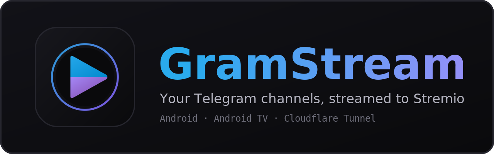
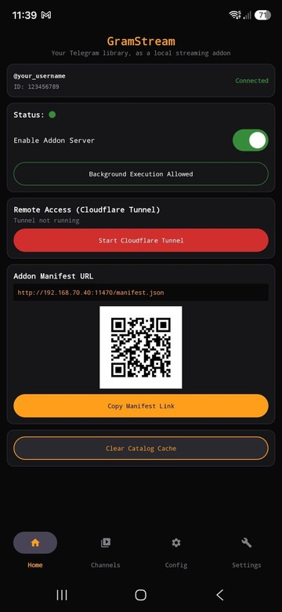

[](LICENSE)

# GramStream

GramStream is an Android app (phone and Android TV) that turns your Telegram
channels into a **Stremio addon** that runs on your own device. You log in with
your Telegram account, pick the channels that hold your videos, and the app runs
a small HTTP server that Stremio can install from a manifest link. Videos stream
directly from Telegram and support seeking. You don't need a VPS or a PC.

To use it outside your home network, the app has a built-in **Cloudflare
Tunnel** that gives you a public `https://….trycloudflare.com` URL with one tap.

## Screenshot



The **Home** tab shows:
- the logged-in Telegram account
- the server switch and background-execution status
- the Cloudflare Tunnel button
- the addon manifest URL with a QR code to scan from Stremio
- buttons to copy the link and clear the catalog cache

---

## Features

### Telegram login
- On first launch you enter your own **API ID / API Hash** from
  [my.telegram.org](https://my.telegram.org). They are stored on the device,
  never hard-coded (`ApiCredentialsActivity.kt`).
- Phone number → login code → 2FA password, driven by TDLib's auth state
  machine (`LoginActivity.kt`, `TdLibManager.kt`).
- When you're already logged in, the app goes straight to the main screen.

### Stremio addon server
- An embedded [NanoHTTPD](https://github.com/NanoHttpd/nanohttpd) server
  (`AddonServer.kt`) runs inside a foreground service
  (`AddonForegroundService.kt`) on port **11470** by default. The port can be
  changed.
- Endpoints:

  | Path | Purpose |
  |---|---|
  | `/manifest.json` | Addon manifest (catalog, stream, meta; id prefixes `tg_`, `tgz:`, `tt`) |
  | `/catalog/movie/latest[/search=…].json` | "Telegram" catalog: latest videos, with search and paging |
  | `/meta/movie/<id>.json` | Metadata, enriched with TMDB when a key is set |
  | `/stream/movie/<id>.json` | Stream links for Telegram ids **and** IMDb ids (`tt…`) |
  | `/file/<chatId>_<messageId>` | Streams a single video with HTTP Range support |
  | `/zipfile/<chatId>/<base>` | Streams a video stored inside split `.zip.001/.002/…` archives |

- CORS headers are set on every response, so Stremio Web works too.

### Catalog and search (`CatalogRepository.kt`)
- Lists and searches video messages in your channels through TDLib.
- **Multi-channel:** you add channels by numeric chat ID on the *Channels* tab.
- **Global Search** (optional): searches every chat you've joined instead of
  only the channels you added.
- Split `.zip.NNN` volumes are grouped into one catalog entry
  (`ZipVolumeResolver.groupVolumes`).
- Posters and metadata come from **TMDB** when you set an API key. Enrichment
  runs in the background, and the catalog is cached for 15 minutes.

### IMDb-id stream resolution
When Stremio asks for streams for a Cinemeta item such as
`/stream/movie/tt0398286.json`:
1. `TmdbClient.findByImdbId` resolves the IMDb id to a title and year.
2. Query templates from `assets/remote_config.json` (`"{title} {year}"`,
   `"{title}"`) build the Telegram search strings, which are tried in order.
3. `Fuzzy.similarity` (token overlap plus Levenshtein ratio) filters the
   results using `title_threshold_fuzzy`.
4. Each match is returned as a `/file/...` or `/zipfile/...` stream (up to
   `max_streams`).

### Streaming engine
- **Progressive streaming with seeking** (`ProgressiveFileInputStream.kt`):
  it starts the TDLib download at the requested byte offset and serves bytes
  as they arrive. A seek starts a new download at the new offset.
- **Multi-volume zip streaming** (`ZipVolumeResolver.kt`,
  `MultiVolumeProgressiveInputStream.kt`):
  - It reads the zip local file header of volume 1 to find where the video
    data starts. Resolved plans are cached.
  - It presents all volumes to the player as one continuous byte range.
  - It **prefetches the next volume** once playback gets within about 8 MB of
    the end of the current one, so playback doesn't stall at the volume
    boundary.

### Cloudflare Tunnel (`CloudflaredTunnel.kt`)
- The `cloudflared` binary is bundled as `jniLibs/<abi>/libcloudflared.so`.
  The `.so` name and `useLegacyPackaging true` make Android extract it to
  `nativeLibraryDir`, where it is allowed to run.
- Tapping **Start Cloudflare Tunnel** on the Home tab runs
  `cloudflared tunnel --url http://127.0.0.1:<port>` (IPv4, http2). The app
  reads the `*.trycloudflare.com` URL from its output and saves it as the
  public host.
- While the tunnel runs, the manifest link and QR code switch to
  `https://<tunnel>/manifest.json`, so you can install the addon from
  anywhere. Stopping the tunnel switches back to the LAN address.
- Quick tunnels need no Cloudflare account, but the URL **changes every time
  the tunnel starts**. Reinstall the addon in Stremio after a restart.

### Home tab
- Server on/off switch with a status indicator.
- Manifest link with a **Copy** button and a **QR code**. When no tunnel is
  running, the LAN IP is detected automatically. The link and QR code refresh
  when the network changes, for example on a Wi-Fi ↔ mobile data handover.
- Start/stop the Cloudflare Tunnel.
- **Allow running in background**: asks Android to exempt the app from
  battery optimization (on TV this is already allowed).
- Clear the catalog cache and TDLib storage.
- Shows the Telegram account that is logged in.

### Config tab
- **Global Search**, **Wi-Fi only** mode and **Auto-start on boot** switches.
- Max cache size (MB, default 2048), buffer size (MB, default 20), server
  port and TMDB API key.

### Settings tab
- In-app debug log viewer (last 500 entries) with **Copy logs**. Long-press
  the log window to open a storage diagnostics report.
- **Backup settings** to a JSON file (API credentials, TMDB key, channels and
  config). To restore it on a new install, tap **Restore** on the first-launch
  screen. That fills in your API ID/Hash and brings back your channels and
  config. You still log in to Telegram again, because the session isn't part
  of the backup.
- Log out of Telegram.

### Reliability
- **Foreground service** (`dataSync`) keeps the server alive in the
  background.
- **Network awareness:** the service watches the default network. In Wi-Fi
  only mode it stops itself when Wi-Fi is lost. Handovers are debounced, so a
  brief gap while switching networks doesn't stop it.
- **Boot resilience** (`BootReceiver.kt`): when auto-start is on, the service
  restarts after `BOOT_COMPLETED` / `QUICKBOOT_POWERON`. The service also
  starts TDLib itself on a cold start, so catalogs aren't empty after a reboot.
- **Storage limits:** a 60-second timer plus read-based cleanup keep the TDLib
  cache under the configured max size.

### Android TV
- Leanback launcher entry and TV banner. Touchscreen is not required.
- Landscape layout on TV, portrait on phones.
- Native libraries for `arm64-v8a` and `armeabi-v7a`, which covers 32-bit TV
  boxes.

---

## Project structure

```
app/src/main/
├── AndroidManifest.xml
├── assets/remote_config.json          # search templates, thresholds, video extensions
├── jniLibs/<abi>/libtdjni.so          # TDLib native library
├── jniLibs/<abi>/libcloudflared.so    # cloudflared binary (Cloudflare Tunnel)
├── java/org/drinkless/tdlib/          # TDLib Java bindings (Client, TdApi)
└── java/com/example/GramStream/
    ├── ApiCredentialsActivity.kt      # first launch: API ID / Hash
    ├── LoginActivity.kt               # phone / code / 2FA
    ├── MainActivity.kt                # bottom nav host
    ├── HomeFragment.kt  ChannelsFragment.kt  ConfigFragment.kt  SettingsFragment.kt
    ├── AddonForegroundService.kt      # runs the server, network watcher, storage timer
    ├── AddonServer.kt                 # Stremio addon HTTP endpoints
    ├── CatalogRepository.kt           # catalog / meta / stream JSON
    ├── TdLibManager.kt                # TDLib client, auth, downloads, storage
    ├── ProgressiveFileInputStream.kt
    ├── MultiVolumeProgressiveInputStream.kt
    ├── ZipVolumeResolver.kt
    ├── CloudflaredTunnel.kt
    ├── TmdbClient.kt  Fuzzy.kt  RemoteConfig.kt
    ├── Settings.kt  DebugLog.kt  NetworkStateNotifier.kt  BootReceiver.kt
    └── ChannelAdapter.kt
```

---

## Building

Requirements: Android Studio, JDK 17, Android SDK 34 (`minSdk 24`).

1. **TDLib:** `libtdjni.so` and the `org.drinkless.tdlib` Java sources are
   already in the repo. To rebuild them, follow [BUILD_TDLIB.md](BUILD_TDLIB.md).
2. **cloudflared:** `libcloudflared.so` is the Linux/Android `cloudflared`
   binary for each ABI (`linux-arm64` → `arm64-v8a`, `linux-arm` →
   `armeabi-v7a`), renamed with a `.so` extension. To update it, download a
   newer release from
   [cloudflare/cloudflared releases](https://github.com/cloudflare/cloudflared/releases)
   and replace the files.
3. Open the project in Android Studio, let Gradle sync, then use
   **Build → Build APK(s)**.

## Setup guide

### 1. Get your Telegram API credentials
1. Go to [my.telegram.org](https://my.telegram.org) and log in with your
   phone number.
2. Open **API development tools** and create an app. Any name and short name
   will do.
3. Copy the **App api_id** (a number) and the **App api_hash**. You enter
   these in GramStream on first launch.

### 2. Create your channel
1. In Telegram, tap **New Channel**. A **private** channel is fine and
   recommended.
2. Upload or **forward** your movie files to it. You can send them as a
   video or as a file/document; both work.
3. The account you log in to GramStream with **must be a member** of the
   channel. It's easiest to log in with the account that owns it.

**Naming files:** GramStream reads the **caption** first, or the **file name**
if there is no caption. Everything before the year becomes the title, and the
year is the first `19xx`/`20xx` it finds. Dots and underscores become spaces.

| Good name / caption | Parsed as |
|---|---|
| `Oppenheimer.2023.1080p.BluRay.x264.mkv` | Oppenheimer (2023) |
| `The_Dark_Knight_2008_720p.mp4` | The Dark Knight (2008) |
| `Interstellar (2014) 2160p.mkv` | Interstellar (2014) |

- Always put the **year right after the title**. It makes TMDB and IMDb
  matching much more accurate.
- **Big files (over 2 GB / 4 GB Premium):** zip the movie, split the archive,
  and upload the parts with the same base name: `Movie.2020.1080p.zip.001`,
  `Movie.2020.1080p.zip.002`, …. GramStream joins them into **one** catalog
  entry and streams them as a single video. The zip **must** use *Store*
  (no compression; in 7-Zip set **Compression level: Store** and **Split to
  volumes**), with one movie per archive, as a standard zip (not ZIP64).
  GramStream streams the raw bytes, so a compressed zip won't play.
- Only zip split archives are joined. Plain `.mkv.001` splits and
  "Part 1 / CD1" files are not joined.
- Series aren't supported yet. Only movies are.

### 3. Get the channel ID
GramStream needs the channel's numeric ID. For channels it always starts with
**`-100`**, for example `-1001234567890`. Any of these four methods works.

#### Method A: with an ID bot (works on phone)
1. In Telegram, search for **[@getidsbot](https://t.me/getidsbot)** (or
   **[@userinfobot](https://t.me/userinfobot)**, or
   **[@RawDataBot](https://t.me/RawDataBot)**) and tap **Start**.
2. Open **your channel**, long-press any message (for example one of your
   movie files) and tap **Forward**.
3. Pick the bot's chat as the destination and send.
4. The bot replies with info about where the message came from. Copy the ID
   shown for the **origin chat / forwarded from chat**:
   - **@getidsbot:** under **Origin chat** → `id: -1001234567890`
   - **@userinfobot:** the line with the channel's **Id**
   - **@RawDataBot:** in the JSON, `"forward_from_chat": { "id": -1001234567890, … }`
5. Make sure you copy the **channel** ID that starts with `-100`, not your own
   user ID (a positive number).

> If forwarding is blocked (the channel has **Restrict saving content**
> turned on), use Method B or C instead. The bot only reads the forwarded
> message's info; it doesn't need to join or be admin in your channel.

#### Method B: from a message link (no bot needed)
1. In your channel, long-press (or right-click) any message and tap **Copy
   Message Link**.
2. For a private channel you get a link like `https://t.me/c/1234567890/42`.
3. Take the number between `/c/` and the next `/` and put **`-100`** in front
   of it: `1234567890` → **`-1001234567890`**.

#### Method C: Telegram Web (on a PC)
1. Open [web.telegram.org/a](https://web.telegram.org/a) and click your
   channel.
2. The address bar shows something like
   `https://web.telegram.org/a/#-1001234567890`. The number after `#` is the
   ID.
3. If you see the `/k/` version (`…/k/#-1234567890`) without the `-100`,
   replace the `-` with **`-100`**: `-1234567890` → `-1001234567890`.

#### Method D: Telegram Desktop
1. Go to **Settings → Advanced → Experimental settings** and turn on **Show
   Peer IDs in Profile**.
2. Open the channel's info page. The ID is shown there. If it doesn't start
   with `-100`, add `-100` in front.

> **Do I need to create my own bot (BotFather)?** No. Some
> Telegram-to-Stremio servers need a BotFather bot that is admin in your
> channels. GramStream logs in **as your
> own Telegram account** through TDLib, so it can read any channel you've
> joined. There's no bot token and no admin setup. The only bot you might use
> is a public ID bot from Method A, once, to look up the channel ID.

### 4. Set up the app
1. Install the APK, then enter your **API ID / API Hash** (or tap
   **Restore** to load a backup).
2. Log in with your phone number, the login code Telegram sends you, and your
   2FA password if you have one.
3. **Channels** tab: paste the `-100…` channel ID and tap **Add**. Repeat for
   each channel. Or turn on **Global Search** in **Config** to search every
   chat you've joined.
4. **Config** tab: add a **TMDB API key** (free at
   [themoviedb.org](https://www.themoviedb.org/settings/api)). You need it for
   posters and for Stremio's normal movie pages to find your files.
5. **Home** tab: tap **Allow running in background**, then turn the server on.

### 5. Connect Stremio
- **Same Wi-Fi:** copy the `http://<phone-ip>:11470/manifest.json` link from
  the Home tab, or scan its QR code.
- **From anywhere:** tap **Start Cloudflare Tunnel**, wait for the
  `https://….trycloudflare.com` address, then copy that link or scan the QR
  code.
- In Stremio, open **Addons**, paste the link into the search box and install.
- Your files show up in the **Telegram** catalog on Stremio's Discover page.
  When TMDB is set up, they also appear as streams on Stremio's normal movie
  pages.

---

## Known limitations
- Only the `movie` type is exposed. Series templates exist in
  `remote_config.json`, but series/episode streams aren't wired up yet.
- Restore needs a system file picker. Some Android TV boxes don't have one,
  so on those, restore on a phone or install a file manager.
- Quick-tunnel URLs change on every start. A named Cloudflare tunnel with a
  fixed hostname isn't supported yet.
- `ZipVolumeResolver` assumes a standard (non-ZIP64) local file header and a
  single entry per archive, i.e. one movie split and zipped for size.
- If the zip used a data descriptor (compressed size unknown at write time),
  the entry length falls back to "everything after the header". The stream
  may then include a few trailing zip bytes, which most players tolerate.
- Stream responses are always sent as `video/x-matroska`.
- Not built yet: anime/Kitsu matching and an OTA self-updater.

---

## License

GramStream is free software, licensed under the
**[GNU General Public License v3.0](LICENSE)** (GPL-3.0), the same license as
[Telegram-Stremio](https://github.com/weebzone/Telegram-Stremio), which
inspired it.

You may use, study, modify and share it. If you distribute a modified version
or an APK built from it, you must release its source code under GPL-3.0 too,
and keep the copyright and license notices.

```
GramStream - stream your Telegram channels to Stremio from Android
Copyright (C) 2026 GLlgGL

This program is free software: you can redistribute it and/or modify
it under the terms of the GNU General Public License as published by
the Free Software Foundation, either version 3 of the License, or
(at your option) any later version.

This program is distributed in the hope that it will be useful,
but WITHOUT ANY WARRANTY; without even the implied warranty of
MERCHANTABILITY or FITNESS FOR A PARTICULAR PURPOSE.  See the
GNU General Public License for more details.
```

Bundled third-party components keep their own licenses: TDLib (Boost
Software License 1.0), cloudflared (Apache 2.0), NanoHTTPD (BSD 3-Clause),
ZXing (Apache 2.0) and AndroidX/Material (Apache 2.0).

---

## Credits
- The idea and design are based on
  [weebzone/Telegram-Stremio](https://github.com/weebzone/Telegram-Stremio)
  by Karan, a self-hosted Telegram → Stremio server (FastAPI, MongoDB,
  PyroFork, GPL-3.0). GramStream brings the same concept to a single Android
  device, with no VPS, database or bot.
- [TDLib](https://github.com/tdlib/td) by Telegram,
  [cloudflared](https://github.com/cloudflare/cloudflared) by Cloudflare,
  [NanoHTTPD](https://github.com/NanoHttpd/nanohttpd),
  [ZXing](https://github.com/zxing/zxing) and
  [TMDB](https://www.themoviedb.org/) for metadata. *This product uses the
  TMDB API but is not endorsed or certified by TMDB.*
- [Stremio](https://www.stremio.com/) addon protocol.

Vibe coded by [GLlgGL](https://github.com/GLlgGL)
